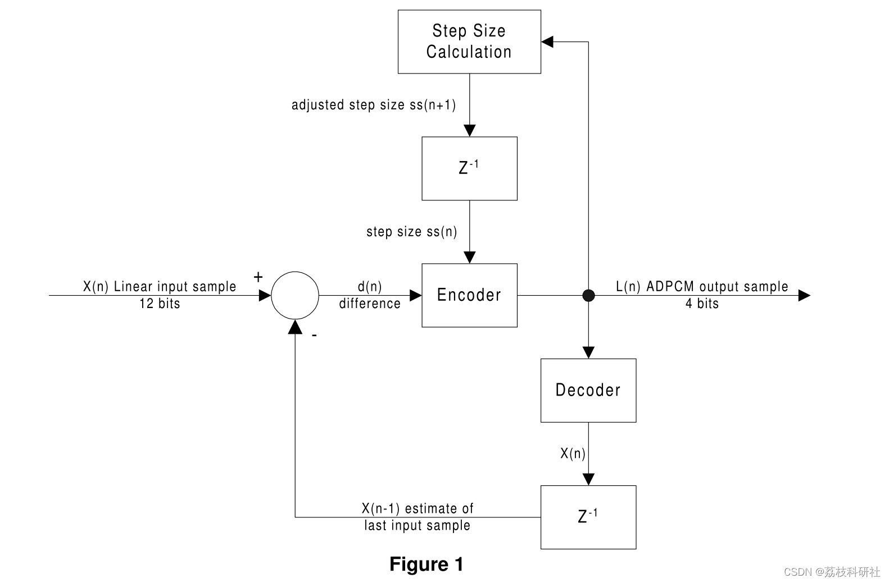
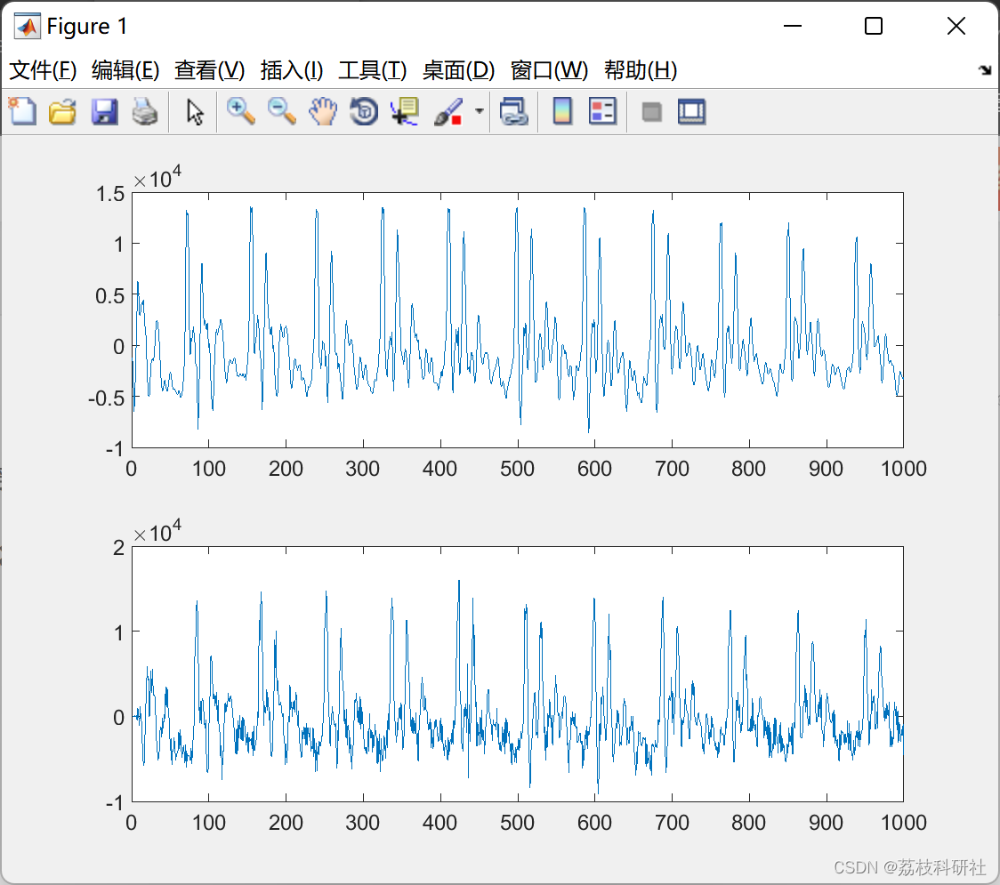

# [Voice Coding]ADPCM coding and decoding based on MATLAB (Matlab code implementation)

​  
Editor
The encoder accepts the difference d(n) and step from the comparator and calculates a 4-bit ADPCM code.
📚2 Running Results Editing
🌈3 Matlab code + voice section code:
%Quantizer Adaptation variable Declarations  
rlt1=0;  
al1=0;  
rlt2=0;  
al2=0;  
detl =32;  
dec_detl = 32;  
deth = 8;  
dec_deth = 8;  
nbl = 0;  
plt1 =0;  
plt2 =0;  
deth=0;  
nbh =0;  
ah1 =0;  
ah2 =0;  
ph1 =0;  
ph2 =0;  
rh1 =0;  
rh2 = 0;  
%Lo and Hi Band Decoder Variable Declarations  
dec_nbl = 0;  
dec_al1 =0;  
dec_al2 =0;  
dec_plt1 =0;  
dec_plt2 =0;  
dec_rlt1 =0;  
dec_rlt2 = 0;  
dec_nbh =0;  
dec_ah1 =0;  
dec_ah2 =0;  
dec_ph1 =0;  
dec_ph2 =0;  
dec_rh1 =0;  
dec_rh2 = 0;  
% signal input to the quantizer and predi  
xl=0;  
sl=0;  
el=0;  
prev_sample=0;  
%samples to be encoded and decoded  
NumOfSamples=1022;  
%the pcm code this is a uniform pcm code 16 bits  
m=pcm('dantaleabrr.wav',NumOfSamples);  
% the first  
m=floor((m(23:end)));  
for i=1:length(m)  
t2=m(i);  
t1=floor(0.5*(t2+prev_sample));  
prev_sample=t2;  
[il,ih,tqmf,rlt1,rlt2,al1,al2,ah1,ah2,plt1,plt2,ph1,ph2,rh1,rh2,nbh,nbl,deth,detl,delay_bpl, delay_dltx,delay_bph,delay_dhx,el,sl,xl]=encode(t1,t2,tqmf,delay_bpl,delay_dltx,delay_bph,delay_dhx,rlt1,rlt2,rh1,rh2,al1,al2,ah1,ah2,plt1,plt2,ph1,ph2,nbh,nbl,detl,deth);  
encode_var(1,i)=il;  
encode_var(2,i)=ih;  
%Here there arrays are for debuging  
xls(1,i)=xl;  
els(1,i)=el;  
sls(1,i)=sl;  
%%%%  
end;  
for i=1:length(m)  
il=encode_var(1,i);  
ih=encode_var(2,i);  
[xout1,xout2,accumc,accumd,dec_del_dltx,dec_del_bpl,dec_del_dhx,dec_del_bph,dec_al1,dec_al2,dec_ah1,dec_ah2,dec_plt1,dec_plt2,dec_ph1,dec_ph2,dec_rlt1,dec_rlt2,dec_detl,dec_nbl,dec_nbh,dec_deth]=decode(il,ih,accumc,accumd,dec_del_bpl,dec_del_dltx,dec_del_bph,dec_del_dhx,dec_rh1,dec_rh2,dec_rlt1,dec_rlt2,dec_al1,dec_al2,dec_ah1,dec_ah2,dec_plt1,dec_plt2,dec_ph1,dec_ph2,dec_detl,dec_nbl,dec_nbh,dec_deth);  
outputcode(i)=0.5*(xout1+xout2);  
end;  
%%get figures  
subplot(2,1,1); plot(m);  
subplot(2,1,2); plot(outputcode);  
🎉4 References
​  

## Images

<!-- PAYMENT_BLOCK -->

## Get this dataset

- Payment link (Stripe): [Buy now](https://buy.stripe.com/3cs8yP7sY87d0vu9AB)
- Payment QR code: 

<!-- /PAYMENT_BLOCK -->
